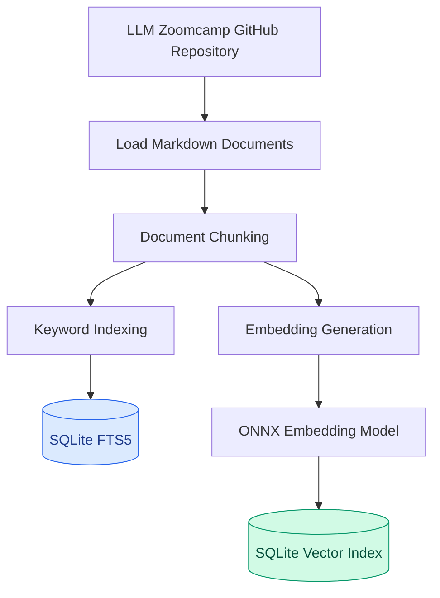
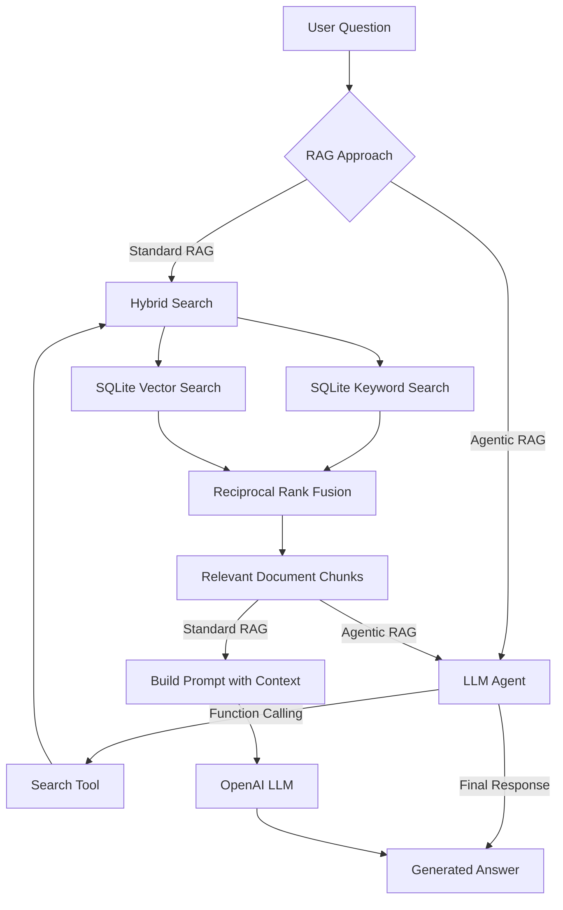

# Building Hybrid RAG & AI Agents with Python

**A Retrieval-Augmented Generation system combining keyword search, vector search, SQLite persistence, and LLM-powered agents.**

Developed as part of [LLM Zoomcamp 2026](https://github.com/DataTalksClub/llm-zoomcamp) by DataTalks.Club.

## Project Overview

This project explores how different information retrieval techniques can be combined to improve document search in Retrieval-Augmented Generation (RAG) systems.

The application works with lesson materials from the LLM Zoomcamp GitHub repository. It retrieves relevant document chunks and uses them to answer questions about the course.

The project implements two approaches:

- **Standard RAG:** Retrieves relevant documents once and generates an answer using the retrieved context.
- **Agentic RAG:** Uses OpenAI function calling to let an LLM perform multiple searches before generating an answer.

Unlike the earlier keyword-based RAG implementation, this project introduces semantic search, Reciprocal Rank Fusion (RRF), and persistent SQLite indexes.

The main goal was to understand how hybrid retrieval works and integrate it into a modular Python application without relying on a high-level RAG framework.

## Key Features

- **Keyword Search:** Full-text retrieval using SQLite FTS5.
- **Vector Search:** Semantic retrieval using locally generated embeddings.
- **Hybrid Search:** Combines keyword and vector search results.
- **Reciprocal Rank Fusion:** Merges ranked results from different retrieval methods.
- **SQLite Persistence:** Stores search indexes locally, avoiding repeated embedding generation.
- **Standard RAG:** Generates answers using retrieved course materials.
- **Agentic RAG:** Allows an LLM to call a search tool and perform multiple retrieval operations.
- **Agent Loop Limit:** Limits the agent to five OpenAI API iterations to control unnecessary requests and costs.

## System Architecture

The system has two main stages: document indexing and question answering.

### 1. Document Indexing

Course materials are downloaded from GitHub, divided into overlapping chunks, and indexed using two different retrieval methods.



The resulting SQLite databases are stored locally:

- `chunks_text.db` — keyword search index.
- `chunks_vector.db` — vector search index.

Both databases can be reopened without rebuilding the indexes or recalculating document embeddings.

### 2. Hybrid RAG and Agentic RAG

Both approaches use the same Hybrid Search implementation.



In Standard RAG, retrieval is performed once before answer generation.

In Agentic RAG, the model controls the retrieval process and can perform additional searches when necessary.

## How Hybrid Search Works

Traditional keyword search and semantic vector search use different approaches to finding relevant information.

### Keyword Search

Keyword Search uses SQLite FTS5 to retrieve document chunks based on matching terms.

It is particularly useful when the user includes specific terminology appearing in the documents.

### Vector Search

Vector Search represents text as numerical embeddings.

This project uses the `Xenova/all-MiniLM-L6-v2` embedding model through ONNX Runtime.

Document embeddings are generated locally and stored in a SQLite vector index using IVF mode.

Unlike keyword search, vector search can retrieve semantically related content even when the query and document use different wording.

### Reciprocal Rank Fusion (RRF)

Hybrid Search combines results from both methods using Reciprocal Rank Fusion.

RRF assigns scores based on document positions in each ranked list:

\[
RRF(d)=\sum_{i=1}^{N}\frac{1}{k+r_i(d)}
\]

Where:

- `d` is a document.
- `N` is the number of retrieval methods.
- `k` is a ranking constant (60 in this project).
- `r_i(d)` is the document's position in a ranked list.

The implementation uses zero-based ranks, following the original homework convention.

Documents appearing in multiple retrieval results accumulate scores from both methods.

To identify the same chunk across search methods, the system uses its `filename` and `start` metadata.

The highest-ranked chunks are returned for further processing.

## Standard RAG vs Agentic RAG

The project implements two different approaches to generating answers.

| Feature | Standard RAG | Agentic RAG |
|---|---|---|
| Retrieval | Single search | Multiple searches possible |
| Search queries | Based on the user's question | Generated by the LLM |
| LLM interaction | Answer generation | Tool calling and answer generation |
| Execution | Fixed pipeline | Iterative agent loop |
| Search strategy | Predefined | Model-directed |
| API requests | One generation request | Up to five iterations |

### Standard RAG

Standard RAG follows a predefined pipeline:

1. Receive a question.
2. Retrieve the most relevant chunks using Hybrid Search.
3. Build a prompt containing the retrieved context.
4. Generate an answer through the OpenAI API.

### Agentic RAG

Agentic RAG provides the LLM with a `search` function.

The model can generate search queries, retrieve additional information, and decide whether another search is necessary before answering.

The agent uses an iterative function-calling loop and includes a maximum of five API iterations to prevent uncontrolled execution.

This limit controls API requests, not the number of individual searches. Multiple tool calls can occur within one iteration.

If the iteration limit is reached without a final answer, the agent returns a fallback message.

## Tech Stack

| Technology | Purpose |
|---|---|
| Python 3.12 | Main programming language |
| OpenAI API | Answer generation and function calling |
| SQLite | Persistent local search storage |
| SQLite FTS5 | Keyword search |
| SQLite Vector Search | Semantic retrieval |
| ONNX Runtime | Local embedding model inference |
| all-MiniLM-L6-v2 | Text embeddings |
| NumPy | Numerical operations |
| GitSource | Loading and chunking GitHub documents |
| Jupyter Notebook | Interactive demonstration |
| uv | Dependency and environment management |

## Project Structure

```text
llm-zoomcamp-2026-course-homework-2/
│
├── data.py             # GitHub document ingestion and chunking
├── download.py         # ONNX model download utility
├── embedder.py         # Local embedding generation
├── search.py           # Keyword, vector, hybrid search and RRF
├── rag.py              # Standard RAG implementation
├── agent.py            # Agentic RAG and function calling
├── demo.ipynb          # Main interactive demonstration
│
├── pyproject.toml      # Project dependencies
├── uv.lock             # Locked dependency versions
├── .python-version     # Python version
├── .gitignore
└── README.md
```

The embedding model and SQLite databases are generated locally and excluded from version control.

## Getting Started

### 1. Clone the repository

```bash
git clone https://github.com/kyivskyiartur/llm-zoomcamp-2026-course-homework-2.git

cd llm-zoomcamp-2026-course-homework-2
```

### 2. Install dependencies

Make sure [uv](https://docs.astral.sh/uv/) is installed.

Run:

```bash
uv sync
```

This installs the project dependencies using the versions specified in `uv.lock`.

The project uses Python 3.12, specified in `.python-version`.

### 3. Configure OpenAI API

Create a `.env` file in the project root:

```env
OPENAI_API_KEY=your_openai_api_key
```

The `.env` file is excluded from Git.

An OpenAI API key is required for Standard RAG and Agentic RAG. Local retrieval can be tested without an OpenAI API request.

### 4. Open the demonstration notebook

Open `demo.ipynb` in VS Code or Jupyter.

Select the Python interpreter from the project's `.venv` environment.

The notebook contains seven steps, each with comments explaining when it should be executed.

### 5. First-time setup

On the first run, execute the notebook steps in this order:

| Step | Description |
|---|---|
| STEP 1 | Download the ONNX embedding model |
| STEP 2 | Initialize the environment |
| STEP 3 | Download course documents and build SQLite indexes |
| STEP 4 | Load the SQLite indexes |
| STEP 5 | Test Hybrid Search |
| STEP 6 | Test Standard RAG |
| STEP 7 | Test Agentic RAG |

The indexing process creates two SQLite database files containing the search indexes.

### 6. Subsequent runs

Once the embedding model and SQLite databases are available locally, you can skip STEP 1 and STEP 3.

Simply execute:

**STEP 2 → STEP 4 → STEP 5 / STEP 6 / STEP 7**

This reuses the existing indexes without rebuilding them.

STEP 5–7 are independent demonstrations and can be executed as needed.

**Note:** Standard RAG and Agentic RAG make OpenAI API requests and may incur usage costs.

## Example Results

### Hybrid Search

**Question:**

> How do I give the model access to tools?

The system retrieves five ranked document chunks using keyword and vector search combined through RRF.

The result includes source metadata such as the original lesson filename and chunk starting position.

### Standard RAG

**Question:**

> How does function calling work?

The system retrieves relevant course materials and generates an explanation of how an LLM requests function execution, how application code executes the function, and how the tool output is returned to the model.

### Agentic RAG

**Question:**

> How does the agentic loop work, and how is it different from plain RAG?

In one local test, the agent:

- Completed the task in 2 API iterations.
- Performed 4 search tool calls.
- Generated an explanation comparing fixed RAG pipelines with iterative, tool-driven agent workflows.

These examples demonstrate the functionality of both approaches. They are not intended as quantitative evidence that one retrieval method outperforms another.

## What I Learned

Working on this project helped me develop practical experience with:

- Generating and working with text embeddings.
- Understanding semantic similarity and vector retrieval.
- Implementing keyword search using SQLite FTS5.
- Building persistent vector indexes with SQLite.
- Combining multiple retrieval methods using RRF.
- Designing modular RAG pipelines in Python.
- Integrating the OpenAI Responses API.
- Implementing function calling and iterative agent workflows.
- Managing Python dependencies and reproducible local development environments.

A key learning outcome was understanding how to move from basic keyword-based retrieval toward a hybrid approach while keeping the application architecture relatively simple.

The project also demonstrates how persistent local indexes can reduce repeated preprocessing work without requiring a separate database server.

## Acknowledgements

This project was developed as part of the [LLM Zoomcamp](https://github.com/DataTalksClub/llm-zoomcamp) course by **DataTalks.Club**.

The `download.py` and `embedder.py` utilities originate from the course materials and are used to download and run the ONNX embedding model.

The modular integration of document ingestion, Hybrid Search, SQLite persistence, Standard RAG, and Agentic RAG was implemented as part of my coursework and independent practice.

Thanks to the DataTalks.Club team and the course instructors for providing the learning materials.
